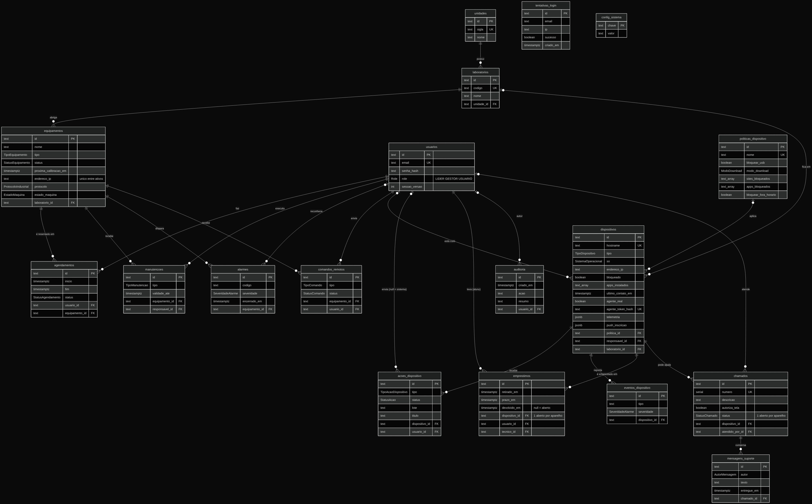

# Banco de dados

PostgreSQL. O schema é definido em `prisma/schema.prisma` e aplicado pelas migrations em `prisma/migrations/` — `0001_init` (núcleo: usuários, áreas, máquinas, reservas, manutenção, auditoria), `0002_conectividade` (máquinas conectadas: alarmes e comandos), `0003_dispositivos` (notebooks e computadores do espaço), `0004_labmaker` (tipo *plotter de recorte*), `0005_seguranca_agente_emprestimos` (empréstimos, tentativas de login, versão de sessão, agente real e **auditoria imutável**) `0006_perfis_lider` (perfis Líder, Professor e Aluno, convertendo os dados antigos), `0007_atendimento_automacao` (pedidos de ajuda, chat, configuração do sistema, push e ações automáticas) e `0008_automacao_unica` (uma ação automática por aparelho e marcador). `npm run db:reset` aplica todas em ordem. São **18 tabelas**.

## Modelo



```
unidades 1 ──< laboratorios 1 ──< equipamentos 1 ──< agendamentos >── 1 usuarios
                                       │                                   │
                                       └──< manutencoes >──────────────────┤ (responsável)
                                                                           │
                                       ├──< alarmes >──────────────────────┤ (reconhecido por, opcional)
                                       └──< comandos_remotos >─────────────┤ (quem enviou)
                                                                           │
                                            auditoria >────────────────────┤ (autor, opcional)
                                                                           │
politicas_dispositivo 1 ──< dispositivos >── laboratorios                  │
                                │  └──────────────────────────────────────┤ (responsável / aluno com o notebook)
                                ├──< acoes_dispositivo >──────────────────┤ (quem enviou)
                                ├──< eventos_dispositivo                   │
                                ├──< emprestimos >────────────────────────┤ (aluno · Líder que emprestou · quem recebeu)
                                └──< chamados >───────────────────────────┘ (Líder que atendeu, opcional)
                                        └──< mensagens_suporte

config_sistema (chave/valor: chaves VAPID do push)

tentativas_login (sem FK: guarda e-mail e IP, inclusive de e-mails que não existem)
```

| Tabela | O que guarda | Relacionamentos |
|---|---|---|
| `unidades` | Campus da faculdade | 1:N com `laboratorios` |
| `laboratorios` | Áreas do espaço maker (Impressão 3D, Corte e Gravação, Bancadas) | N:1 `unidades` · 1:N `equipamentos`, `dispositivos` |
| `equipamentos` | Inventário, status, criticidade, calibração, **IP, protocolo, firmware, câmera, estado físico, último contato** | N:1 `laboratorios` · 1:N `agendamentos`, `manutencoes`, `alarmes`, `comandos_remotos` |
| `usuarios` | Contas, perfil de acesso, hash da senha | 1:N `agendamentos`, `manutencoes`, `auditoria` |
| `agendamentos` | Reservas (início, fim, status, finalidade) | N:1 `usuarios` e `equipamentos` |
| `manutencoes` | Calibrações e manutenções executadas | N:1 `equipamentos` e `usuarios` |
| `alarmes` | Alarmes disparados pelo controlador ou pelo gateway (código, severidade, início, fim, reconhecimento) | N:1 `equipamentos` · N:1 `usuarios` (quem reconheceu) |
| `comandos_remotos` | Todo comando enviado a uma máquina, executado ou recusado, com motivo e justificativa | N:1 `equipamentos` e `usuarios` |
| `politicas_dispositivo` | Regras aplicadas pelo agente: USB, modo de download, categorias de site, apps proibidos, criptografia, bloqueio de tela | 1:N `dispositivos` |
| `dispositivos` | Notebooks, desktops e tablets do espaço: sistema, IP/MAC, versão do agente, segurança, apps instalados, bloqueio, último check-in | N:1 `politicas_dispositivo`, `laboratorios`, `usuarios` (responsável) |
| `acoes_dispositivo` | Tudo o que a equipe mandou fazer (aviso, bloquear, instalar/remover app, suporte remoto, apagar), com status da fila e lote dos avisos em massa | N:1 `dispositivos` e `usuarios` |
| `eventos_dispositivo` | O que o agente reportou: download/USB/site/app bloqueado, conformidade, check-in | N:1 `dispositivos` |
| `emprestimos` | Notebook/tablet emprestado: retirada, prazo, devolução, observação | N:1 `dispositivos` · N:1 `usuarios` (aluno, Líder que emprestou, quem recebeu) |
| `chamados` | Pedidos de ajuda ("Pedir ajuda ao Líder"): número sequencial, descrição, quem pediu, se **autorizou ver a tela**, status (aberto, em atendimento, resolvido, cancelado) e horários | N:1 `dispositivos` · N:1 `usuarios` (Líder que atendeu) · 1:N `mensagens_suporte` |
| `mensagens_suporte` | Chat do atendimento: autor (Líder, usuário, sistema), texto, quando foi **entregue** no aparelho | N:1 `chamados` |
| `config_sistema` | Configurações do servidor em chave/valor (hoje: par de chaves VAPID do Web Push, gerado na primeira vez) | — |
| `tentativas_login` | Cada tentativa de login (e-mail, IP, sucesso) — base do limite contra força bruta | — |
| `auditoria` | Trilha de eventos — **imutável no banco** | N:1 `usuarios` (opcional) |

**Enums:** `Role`, `TipoEquipamento`, `StatusEquipamento`, `Criticidade`, `StatusAgendamento`, `TipoManutencao`, `EstadoMaquina`, `ProtocoloIndustrial`, `SeveridadeAlarme`, `TipoComando`, `StatusComando`, `TipoDispositivo`, `SistemaOperacional`, `ModoDownload`, `TipoAcaoDispositivo`, `StatusAcao`, `StatusChamado`, `AutorMensagem`.

**Colunas novas na 0007:** `dispositivos.push_inscricao` (inscrição Web Push do celular, JSON), `politicas_dispositivo.bloquear_fora_horario` (trava às 20h e no domingo) e `acoes_dispositivo.usuario_id` passou a aceitar nulo — ações criadas pelo **sistema** (lembrete, atraso, fechamento) aparecem como "Sistema LabMaker".

## Integridade

- **Chaves estrangeiras** com política explícita: `RESTRICT` onde apagar quebraria o histórico (laboratório com equipamentos, responsável por manutenção), `CASCADE` em dependentes diretos, `SET NULL` na auditoria (o registro sobrevive ao usuário, com nome e perfil gravados como snapshot).
- **Unicidade:** e-mail, matrícula, patrimônio, sigla da unidade, código do laboratório; **IP da máquina entre equipamentos ativos** (índice único parcial `WHERE ativo`); hostname, número de série e MAC dos dispositivos; nome da política.
- **CHECK:** `fim > inicio` em reservas; duração do horário em 30, 60, 90 ou 120 min; `encerrado_em >= ativo_desde` em alarmes; aviso sempre com título e mensagem; descrição do chamado entre 3 e 500 caracteres; mensagem do chat entre 1 e 1000; bloqueio de tela entre 1 e 120 min; atualizações pendentes ≥ 0.
- **Exclusão lógica:** equipamentos (`ativo`), usuários (`ativo`) e reservas (`status = CANCELADO`) nunca são apagados fisicamente.
- **Senhas:** somente hash bcrypt (`senha_hash`). Tokens do agente: somente SHA-256 (`agente_token_hash`, único).

## Regras garantidas pelo próprio banco

Regras que a aplicação já valida, mas que o PostgreSQL também garante — se um bug ou uma corrida passar pela aplicação, o banco segura:

| Regra | Como |
|---|---|
| Nunca duas reservas no mesmo horário da mesma máquina | Transação com `pg_advisory_xact_lock(hash da máquina)` antes de checar conflito (`models/agendamento.model.ts`). Testado com 50 pedidos simultâneos. |
| Um empréstimo aberto por aparelho | Índice único parcial `emprestimos_um_aberto_por_dispositivo (dispositivo_id) WHERE devolvido_em IS NULL` |
| Prazo depois da retirada; devolução depois da retirada | `CHECK` em `emprestimos` |
| Auditoria não se altera nem se apaga | Função `auditoria_imutavel()` + gatilho `BEFORE UPDATE OR DELETE` (exceção só para a chave de manutenção do seed e para o `SET NULL` quando um usuário é removido) |
| Sessão revogável | `usuarios.sessao_versao`, conferida a cada requisição |
| Um pedido de ajuda aberto por aparelho | Índice único parcial `chamados_um_aberto_por_dispositivo (dispositivo_id) WHERE status IN ('ABERTO','EM_ATENDIMENTO')` — um segundo "Pedir ajuda" reaproveita o aberto |
| Uma ação automática por aparelho e marcador | Índice único parcial `acoes_automaticas_unicas (dispositivo_id, parametro) WHERE parametro LIKE 'auto:%'` (0008). O lembrete pode nascer no **check-in** ou no **agendador**; se os dois rodarem juntos, o segundo recebe P2002 e é ignorado. Testado no e2e. |
| Só três perfis | enum `Role` = `LIDER`, `GESTOR`, `USUARIO` (migration 0006 converteu `TECNICO`/`ADMIN` → `LIDER` e `AUDITOR` → `USUARIO`) |

## Índices

| Índice | Atende |
|---|---|
| `agendamentos (equipamento_id, inicio)` | Consulta de disponibilidade e verificação de conflito |
| `agendamentos (usuario_id, inicio)` | "Minhas reservas" |
| `agendamentos (inicio)` | Painel (séries por dia) e agenda geral |
| `equipamentos (laboratorio_id)`, `(status)`, `(proxima_calibracao_em)` | Filtros e alertas de calibração |
| `manutencoes (equipamento_id, realizada_em)` | Histórico por equipamento |
| `auditoria (criado_em DESC)`, `(entidade, entidade_id)`, `(usuario_id)` | Trilha paginada e filtros |
| `emprestimos (dispositivo_id, retirado_em DESC)`, `(usuario_id)`, `(devolvido_em)` | Histórico do aparelho, "meu empréstimo", abertos |
| `tentativas_login (email, criado_em DESC)`, `(ip, criado_em DESC)` | Contagem de falhas na janela de 15 min |
| `chamados (status, criado_em DESC)` | Fila do Atendimento e selo do menu |
| `chamados (dispositivo_id, criado_em DESC)` | "Este aparelho tem pedido aberto?" a cada check-in |
| `mensagens_suporte (chamado_id, criado_em)` | Conversa em ordem e mensagens ainda não entregues |

## Concorrência

A criação de reserva usa uma transação com `pg_advisory_xact_lock(hashtext(equipamento_id))`. A trava é liberada automaticamente no commit/rollback e só serializa pedidos do mesmo equipamento.

## Consultas úteis para demonstração

```sql
-- Hierarquia completa (3 JOINs)
SELECT u.sigla, l.codigo, e.nome, e.status
FROM equipamentos e
JOIN laboratorios l ON l.id = e.laboratorio_id
JOIN unidades u     ON u.id = l.unidade_id
WHERE e.ativo ORDER BY u.sigla, l.codigo, e.nome;

-- Horas reservadas por laboratório nos últimos 7 dias
SELECT l.codigo, round(sum(extract(epoch FROM a.fim - a.inicio)) / 3600) AS horas
FROM agendamentos a
JOIN equipamentos e ON e.id = a.equipamento_id
JOIN laboratorios l ON l.id = e.laboratorio_id
WHERE a.status <> 'CANCELADO' AND a.inicio >= now() - interval '7 days' AND a.inicio < now()
GROUP BY l.codigo ORDER BY horas DESC;

-- Calibrações vencidas ou a vencer em 30 dias
SELECT nome, patrimonio, proxima_calibracao_em::date AS vence,
       CASE WHEN proxima_calibracao_em < now() THEN 'VENCIDA' ELSE 'A VENCER' END AS situacao
FROM equipamentos
WHERE ativo AND requer_calibracao AND proxima_calibracao_em < now() + interval '30 days'
ORDER BY proxima_calibracao_em;

-- Últimos eventos da auditoria
SELECT criado_em AT TIME ZONE 'America/Sao_Paulo' AS quando, usuario_nome, acao, resumo
FROM auditoria ORDER BY criado_em DESC LIMIT 15;
```
